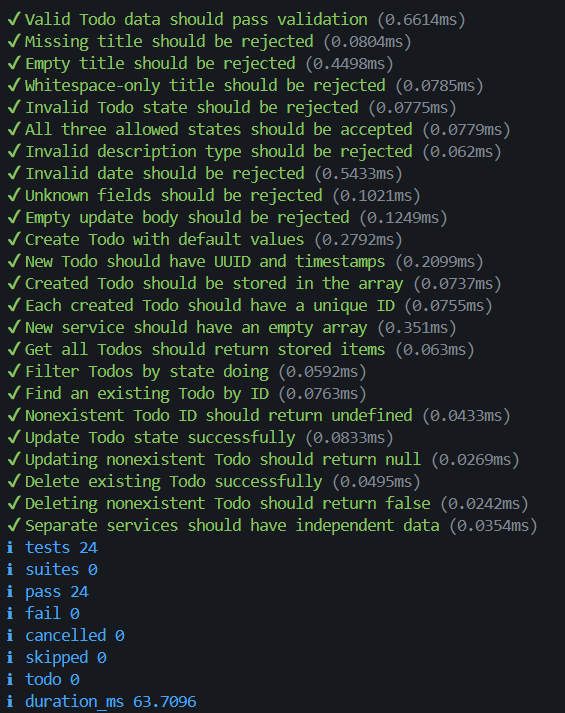
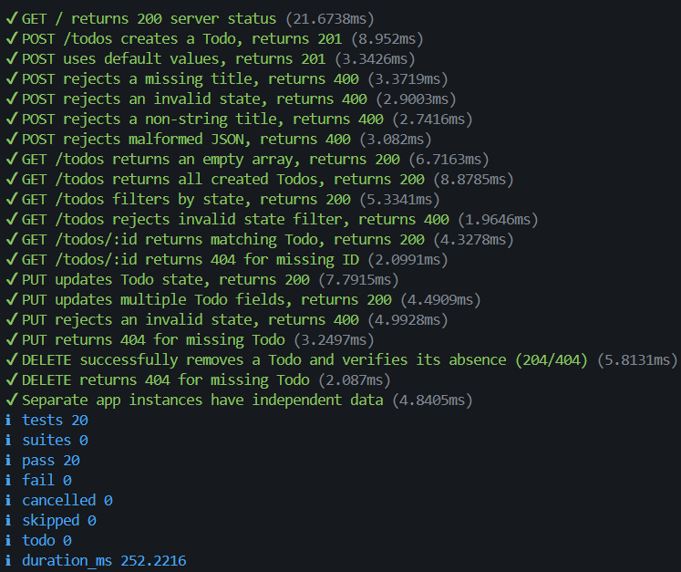

# Todo REST API using Node.js and Express

## 1. Project Overview

This project was developed as part of the REST API assignment for the Software Engineering course at Karelia University of Applied Sciences.

The objective is to build a RESTful API using Node.js and Express.js to manage a Todo list. The API supports CRUD (Create, Read, Update, Delete) operations and allows users to manage Todo items through HTTP requests.

Each Todo item can have one of three states: `todo`, `doing`, or `done`.

The application uses a JavaScript array as temporary data storage instead of a database.

## 2. Technologies Used

- **Node.js:** JavaScript runtime environment for running the server.
- **Express.js:** Web framework for implementing REST API endpoints.
- **JavaScript:** Programming language used for server-side development.
- **JSON:** Format used for request and response data.
- **VS Code:** Development environment.
- **REST Client Extension:** Used to test HTTP requests and API responses.
- **Git and GitHub:** Version control and source code repository.

## 3. Assignment 4 - Project Structure (Before refactoring)

```text
restapi_assignment/
├── server.js
├── todos.rest
├── errors.rest
├── package.json
├── package-lock.json
├── .gitignore
└── README.md
```

Note: This structure represents the initial implementation completed in Assignment 4. The application was subsequently refactored in Assignment 5. See the Refactored Project Structure section below in assignment 5 section.

**File descriptions:**

- `server.js`: Express server and REST API endpoint implementations.
- `todos.rest`: HTTP requests for testing CRUD operations.
- `errors.rest`: HTTP requests for testing client errors.
- `package.json`: Project configuration and dependencies.
- `package-lock.json`: Dependency version information.
- `.gitignore`: Excludes unnecessary files such as `node_modules`.
- `README.md`: Project documentation and reflection.

## 4. Installation and Setup

### Prerequisites

- Node.js and npm
- Visual Studio Code
- REST Client extension for VS Code

### Installation Steps

**Step 1:** Clone the repository.

```bash
git clone https://github.com/Karelia-Software-Projects/restapi_assignment.git
```

**Step 2:** Navigate to the project directory.

```bash
cd restapi_assignment
```

**Step 3:** Install the project dependencies.

```bash
npm install
```

**Step 4:** Start the server.

```bash
node server.js --> Before refactor
npm start --> After refactor - start script is configured in `package.json`.
```

The server runs at:
`http://localhost:3000`

## 5. Todo Data Model

Each Todo item contains the following properties:

| Property    | Type        | Description                               |
| ----------- | ----------- | ----------------------------------------- |
| id          | UUID        | Unique identifier generated automatically |
| title       | String      | Required Todo title                       |
| description | String      | Optional description                      |
| state       | String      | todo, doing, or done                      |
| dueDate     | String/null | Optional due date                         |
| createdAt   | String      | Creation timestamp                        |
| updatedAt   | String      | Last modification timestamp               |

### Example Todo Object

```json
{
  "id": "a1b2c3d4-1234-4321-9876-abcdef123456",
  "title": "Study REST APIs",
  "description": "Learn Node.js and Express",
  "state": "todo",
  "dueDate": null,
  "createdAt": "2026-11-11T10:00:00.000Z",
  "updatedAt": "2026-11-11T10:00:00.000Z"
}
```

## 6. API Endpoints

| HTTP Method | Endpoint            | Description             | Success Code |
| ----------- | ------------------- | ----------------------- | ------------ |
| POST        | `/todos`            | Create a new Todo       | 201          |
| GET         | `/todos`            | Retrieve all Todos      | 200          |
| GET         | `/todos?state=todo` | Filter Todos by state   | 200          |
| GET         | `/todos/:id`        | Retrieve a Todo by ID   | 200          |
| PUT         | `/todos/:id`        | Update an existing Todo | 200          |
| DELETE      | `/todos/:id`        | Delete a Todo           | 204          |

### Create a Todo

**POST /todos**

Request body:

```json
{
  "title": "Study REST APIs",
  "description": "Complete the assignment",
  "state": "todo"
}
```

Expected response: `201 Created`

The response includes the created object with its generated ID and timestamps.

### Retrieve All Todos

**GET /todos**

Expected response: `200 OK`

Returns all existing Todo items as a JSON array.

### Filter Todos by State

**GET /todos?state=doing**

Expected response: `200 OK`

Returns Todo items that match the requested state.

### Retrieve a Specific Todo

**GET /todos/:id**

Expected response: `200 OK`

Returns the Todo item matching the specified ID.

### Update a Todo

**PUT /todos/:id**

Request body:

```json
{
  "state": "doing"
}
```

Expected response: `200 OK`

Updates the specified Todo item and returns the updated object.

### Delete a Todo

**DELETE /todos/:id**

Expected response: `204 No Content`

Removes the requested Todo item from the array.

## 7. Testing

The API was designed to be tested using the REST Client extension in Visual Studio Code.

The following files contain the test requests:

- `todos.rest`: Successful API requests.
- `errors.rest`: Invalid requests and error scenarios.

### Functional Test Cases

| Test                       | Expected HTTP Status |
| -------------------------- | -------------------- |
| Create a Todo              | 201 Created          |
| Retrieve all Todos         | 200 OK               |
| Filter Todos by state      | 200 OK               |
| Retrieve Todo by ID        | 200 OK               |
| Update Todo state          | 200 OK               |
| Update multiple properties | 200 OK               |
| Delete Todo                | 204 No Content       |
| Retrieve deleted Todo      | 404 Not Found        |

### Error Test Cases

| Test                        | Expected HTTP Status |
| --------------------------- | -------------------- |
| Malformed JSON request body | 400 Bad Request      |
| Invalid Todo state          | 400 Bad Request      |
| Missing or empty title      | 400 Bad Request      |
| Retrieve a nonexistent Todo | 404 Not Found        |
| Update a nonexistent Todo   | 404 Not Found        |
| Delete a nonexistent Todo   | 404 Not Found        |

**Note:** Validation test cases must be executed after the corresponding input-validation logic has been implemented.

## 8. Data Storage

The application uses an in-memory JavaScript array to store Todo items.

The following JavaScript methods are used:

- `push()`: Adds a new Todo item.
- `find()`: Finds a Todo item by ID.
- `filter()`: Retrieves Todo items matching a particular state.
- `findIndex()`: Finds the array position of an existing Todo.
- `splice()`: Removes a Todo item from the array.

Since a permanent database is not implemented, all stored Todo items are lost when the server restarts.

## 9. Development Process and Progress

The project was developed in the following stages:

1. Initialized the Node.js project and installed Express.
2. Created a basic Express server running on port 3000.
3. Implemented the POST endpoint to create Todo items.
4. Implemented GET endpoints for retrieving and filtering Todos.
5. Implemented a GET endpoint for retrieving an item by ID.
6. Implemented the PUT endpoint for updating existing items.
7. Implemented the DELETE endpoint for removing items.
8. Added HTTP error handling for nonexistent resources and malformed JSON.
9. Created REST Client requests for testing the API.
10. Prepared the project for version control using Git and GitHub.

## 10. Challenges Encountered

One challenge I encountered was receiving an HTTP `404 Not Found` response while testing the PUT endpoint.

The response displayed `Cannot PUT /todos/:id`, which indicated that Express could not find a matching route.

This helped me understand the importance of defining the correct HTTP method and endpoint, saving the source code, and restarting the Node.js server after making changes.

I also learned how to reuse a dynamically generated Todo ID in REST Client requests using named requests, instead of manually copying UUID values.

## 11. Reflection

Through this assignment, I gained practical experience in developing a RESTful API using Node.js and Express.

Previously, I had worked with REST APIs mainly from the client side using tools such as curl, Postman, and VS Code REST Client. This assignment helped me understand how the server receives HTTP requests, processes data, and sends responses to clients.

I also became more familiar with JavaScript array methods such as `push()`, `find()`, `filter()`, `findIndex()`, and `splice()`, and how they can be used to perform CRUD operations.

Another important learning point was understanding the difference between HTTP status codes such as `200`, `201`, `204`, `400`, and `404`.

The REST Client extension was particularly useful because I could write, execute, and test HTTP requests directly within VS Code.

Overall, this assignment improved my understanding of backend development and REST API design.

## 12. Future Improvements

Possible improvements include:

- Implementing persistent data storage using MySQL or MongoDB.
- Adding further input validation.
- Implementing automated API tests.
- Adding authentication and authorization.
- Creating an API specification using OpenAPI/Swagger.
- Developing a simple frontend application to manage Todo items.

## 13. Repository

GitHub repository:
https://github.com/Karelia-Software-Projects/restapi_assignment.git

**Course:** Software Engineering / REST API Assignment  
**Institution:** Karelia University of Applied Sciences  
**Technology:** Node.js, Express.js, JavaScript

#---------------------------------------------------------------------------------------

Version: 1.1.0 Change Log

# Assignment 5: Unit Testing and Integration Testing

## 1. Assignment Overview

The objective of this assignment was to continue developing the Todo REST API implemented in Assignment 4 by improving its testability and introducing automated unit and integration tests.

The existing application's CRUD functionality was preserved while its internal structure was refactored to separate application logic, API routes, Express configuration, and server startup.

## 2. Refactoring and Testability

### Limitations of the Original Implementation

The original application contained all API endpoints, data operations, validation logic, and server startup code in a single `server.js` file.

This presented several limitations:

- Individual functions could not easily be tested independently.
- Application logic was tightly coupled with HTTP request handlers.
- Importing the server module would immediately start the HTTP server.
- Shared Todo data could affect the independence of automated tests.

### Refactoring Improvements

## New Project Structure

```text
restapi_assignment/
│
├── src/
│ ├── routes/
│ │ └── todo.js
│ │
│ ├── services/
│ │ └── todoService.js
│ │
│ ├── app.js
│ └── server.js
│
├── tests/
│ ├── todo.unit.test.js
│ └── todo.integration.test.js
│
├── docs/
│ ├── unit-test-results.png
│ └── integration-test-results.png
│
├── todos.rest
├── erros.rest
├── git_link.txt
├── package.json
├── package-lock.json
├── .gitignore
└── README.md
```

To address these limitations, the application was divided into separate modules.

| Module                           | Responsibility                                     |
| -------------------------------- | -------------------------------------------------- |
| `src/server.js`                  | Starts the HTTP server                             |
| `src/app.js`                     | Configures Express, middleware, and routes         |
| `src/routes/todo.js`             | Handles HTTP requests and responses                |
| `src/services/todoService.js`    | Manages Todo data, validation, and CRUD operations |
| `tests/todo.unit.test.js`        | Contains automated unit tests                      |
| `tests/todo.integration.test.js` | Contains automated API integration tests           |

The `createTodoService()` function creates an independent service instance with its own in-memory Todo array.

Similarly, the `createApp()` function creates a separate Express application instance. This allows integration tests to run independently without manually starting the HTTP server.

Dependency injection was used to pass the Todo service into the Express router, reducing dependencies between modules and improving testability.

## 3. Application Architecture

The refactored application follows a modular structure:

```text
HTTP Client / Supertest
         |
         v
      app.js
         |
         v
   routes/todo.js
         |
         v
services/todoService.js
         |
         v
   In-memory Array
```

The route layer handles HTTP communication, while the service layer is responsible for application logic and data operations.

## 4. Testing Tools

The following tools were used to implement automated testing:

- **Node.js Test Runner (`node:test`):** Defines and executes automated test cases.
- **Node.js Assert Module (`node:assert/strict`):** Compares actual results with expected results.
- **Supertest:** Sends HTTP requests to the Express application and verifies API responses.
- **VS Code REST Client:** Used for manual testing of REST API endpoints.

## 5. Unit Testing

Unit tests were implemented to verify individual functions in the Todo service without requiring Express or HTTP requests.

A total of 24 unit tests were implemented.

### Unit Test Coverage

| Function              | Tested Scenarios                                                                                              |
| --------------------- | ------------------------------------------------------------------------------------------------------------- |
| `validateTodo()`      | Valid input, missing title, empty title, invalid state, invalid description, invalid date, and unknown fields |
| `createTodo()`        | Default values, UUID generation, timestamps, and data storage                                                 |
| `getAllTodos()`       | Empty array, retrieving all items, and state filtering                                                        |
| `getTodoById()`       | Existing and nonexistent Todo IDs                                                                             |
| `updateTodo()`        | Successful updates and nonexistent Todo IDs                                                                   |
| `deleteTodo()`        | Successful deletion and nonexistent Todo IDs                                                                  |
| `createTodoService()` | Independent service instances                                                                                 |

Each unit test creates a new Todo service instance to ensure that test data does not interfere with other test cases.

## 6. Integration Testing

Integration tests were implemented using Supertest to verify that the API routes, validation logic, service functions, and HTTP responses work together correctly.

A total of 20 integration tests were implemented.

### Integration Test Coverage

| Endpoint          | Tested Scenarios                                                     | Expected Status |
| ----------------- | -------------------------------------------------------------------- | --------------- |
| GET /             | Server status                                                        | 200             |
| POST /todos       | Successful creation and default values                               | 201             |
| POST /todos       | Missing title, invalid state, invalid title type, and malformed JSON | 400             |
| GET /todos        | Empty list, retrieving all Todos, and state filtering                | 200             |
| GET /todos        | Invalid state filter                                                 | 400             |
| GET /todos/:id    | Retrieving an existing Todo                                          | 200             |
| GET /todos/:id    | Nonexistent Todo                                                     | 404             |
| PUT /todos/:id    | Successful state and property updates                                | 200             |
| PUT /todos/:id    | Invalid state                                                        | 400             |
| PUT /todos/:id    | Nonexistent Todo                                                     | 404             |
| DELETE /todos/:id | Successful deletion                                                  | 204             |
| DELETE /todos/:id | Nonexistent Todo                                                     | 404             |

The integration tests also verify response data, generated IDs, timestamps, the Location response header, and independent application instances.

Follow-up GET requests were used to confirm that successful updates and deletions were correctly reflected in the stored data.

## 7. Executing Automated Tests

Install the project dependencies:

```bash
npm install
```

Run all automated tests:

```bash
npm test
```

Run unit tests separately:

```bash
node --test tests/todo.unit.test.js
```

Run integration tests separately:

```bash
node --test tests/todo.integration.test.js
```

Generate a code coverage report:

```bash
node --test --experimental-test-coverage
```

Supertest allows integration tests to execute without manually starting the Express server.

## 8. Test Results

All 44 automated tests were executed successfully using the `npm test` command.

| Test Category     |  Total | Passed | Failed |
| ----------------- | -----: | -----: | -----: |
| Unit Tests        |     24 |     24 |      0 |
| Integration Tests |     20 |     20 |      0 |
| **Total**         | **44** | **44** |  **0** |

**Test pass rate:** 100%
**Total execution time:** Approximately 275.08 milliseconds
**Skipped tests:** 0
**Cancelled tests:** 0

Terminal output:

```text
tests 44
suites 0
pass 44
fail 0
cancelled 0
skipped 0
todo 0
duration_ms 275.0807
```

### Unit Testing Results

A total of 24 unit tests were executed successfully, covering validation, Todo creation, retrieval, updating, deleting, and service independence.

**Results: 24 passed, 0 failed.**



### Integration Testing Results

A total of 20 integration tests were executed successfully using Supertest. The tests verified CRUD endpoints, HTTP status codes, response data, validation errors, and nonexistent resources.

**Results: 20 passed, 0 failed.**



These results confirm that all implemented test cases passed, including successful CRUD operations, input validation, error handling, and test data isolation.

## 9. Personal Reflection

Through this assignment, I gained a better understanding of the importance of writing testable code and separating different responsibilities within a software application.

In Assignment 4, I implemented the REST API endpoints and application logic within a single JavaScript file. Although the application was functional, I realised that this structure made it difficult to test individual operations independently.

Refactoring the application into separate route and service modules helped me understand how a modular application structure improves maintainability and testability.

Unit testing helped me verify the behaviour of individual JavaScript functions, while integration testing allowed me to examine how the different application components interact through HTTP requests.

Previously, I used the REST Client extension and Postman to test API endpoints manually. With automated testing, I can now execute multiple test cases using a single command and immediately identify unexpected behaviour.

I also learned the importance of testing unsuccessful operations, such as invalid input, malformed JSON, and requests for nonexistent resources, rather than focusing only on successful scenarios.

Another valuable learning experience was understanding how independent service and application instances prevent test cases from affecting one another.

Overall, this assignment improved my understanding of software testing, modular application design, and backend development using Node.js and Express.

## 10. Future Improvements

The application could be further improved by:

- Implementing persistent data storage using a database.
- Introducing automated testing through GitHub Actions.
- Implementing authentication and authorization.
- Adding automated tests for database operations.

## 11. Conclusion

The existing Todo REST API was successfully refactored to improve its structure and testability without rewriting its core functionality.

A total of 24 unit tests and 20 integration tests were implemented, and all 44 automated tests passed successfully.

The assignment provided practical experience in refactoring, automated testing, dependency injection, HTTP error handling, and modular backend application development.

---

# Assignment 6: OpenAPI Documentation and CSV Support

## 1. Assignment Overview

The objective of Assignment 6 was to extend the existing Todo REST API by implementing OpenAPI documentation and adding support for CSV responses.

The application was developed in Assignments 4 and 5 using Node.js and Express. The existing CRUD operations and modular application structure were preserved.

Two main improvements were implemented:

1. Interactive OpenAPI documentation using Swagger UI.
2. Support for JSON and CSV response formats in the `GET /todos` endpoint.

## 2. Technologies Used

The following packages were added:

- **swagger-ui-express:** Provides an interactive web interface for API documentation.
- **yaml:** Parses the OpenAPI specification written in YAML.

The OpenAPI specification uses version **3.0.3**.

## 3. OpenAPI Documentation

The API documentation was implemented using Swagger UI and is accessible locally at:

**http://localhost:3000/doc**

The OpenAPI specification is stored in:

`src/docs/openapi.yaml`

The specification defines the API endpoints, HTTP methods, request parameters, request bodies, response formats, status codes, and Todo data schemas.

### Documented API Endpoints

| Method | Endpoint      | Description                           |
| ------ | ------------- | ------------------------------------- |
| GET    | `/`           | Check server status                   |
| POST   | `/todos`      | Create a new Todo                     |
| GET    | `/todos`      | Retrieve all Todos or filter by state |
| GET    | `/todos/{id}` | Retrieve a Todo by ID                 |
| PUT    | `/todos/{id}` | Update an existing Todo               |
| DELETE | `/todos/{id}` | Delete a Todo                         |

Swagger UI allows API requests to be executed directly from the documentation page using the **Try it out** feature.

No authentication is required for this assignment.

## 4. CSV Response Support

The `GET /todos` endpoint was modified to support both JSON and CSV responses.

The server determines the response format using the HTTP `Accept` request header.

### JSON Response

Request:

```http
GET http://localhost:3000/todos
Accept: application/json
```

The server returns a JSON array of Todo items.

### CSV Response

Request:

```http
GET http://localhost:3000/todos
Accept: text/csv
```

Example CSV response:

```csv
id,title,description,state,dueDate,createdAt,updatedAt
123,Complete Assignment 6,Test CSV response,done,,2026-11-24T22:05:09.546Z,2026-11-24T22:05:09.546Z
```

The CSV output includes the following fields:

`id`, `title`, `description`, `state`, `dueDate`, `createdAt`, and `updatedAt`.

### State Filtering with CSV

The existing state filter is also supported when requesting CSV data.

Example:

```http
GET http://localhost:3000/todos?state=done
Accept: text/csv
```

The response contains only Todo items with the state `done`.

## 5. Implementation Details

### CSV Conversion

Two functions were added to `src/services/todoService.js`:

- `escapeCsv()`: Handles CSV values containing commas, quotation marks, and newline characters.
- `toCsv()`: Converts an array of Todo objects into CSV format.

### HTTP Content Negotiation

The `GET /todos` route in `src/routes/todo.js` was modified to examine the client's `Accept` header.

The endpoint supports:

| Accept Header           | Response           |
| ----------------------- | ------------------ |
| `application/json`      | JSON               |
| `text/csv`              | CSV                |
| Missing header or `*/*` | JSON               |
| Unsupported media type  | 406 Not Acceptable |

The server sets the appropriate `Content-Type` response header based on the selected format.

## 6. OpenAPI Specification Updates

The OpenAPI specification defines both `application/json` and `text/csv` as supported response formats for `GET /todos`.

This allows API users to select the required response format through Swagger UI.

## 7. Verification

The OpenAPI documentation was checked through the browser at `http://localhost:3000/doc`.

The GET and POST endpoints were successfully executed through Swagger UI.

CSV functionality was verified using VS Code REST Client.

The CSV response returned HTTP `200 OK`, the `text/csv` content type, and Todo data in the expected column format.

The state filter was also verified using a Todo item with the state `done`.

## 8. Conclusion

Assignment 6 extended the Todo REST API with interactive API documentation and support for CSV responses.

The existing CRUD functionality was preserved, while the `GET /todos` endpoint was extended to return data in the format requested by the client.

The application now provides OpenAPI documentation and supports both JSON and CSV representations of Todo data.

Assignment 7: JWT Authentication with Access and Refresh Tokens

1. Assignment Overview
   This assignment extends the Todo REST API from Assignments 4, 5, and 6 with JWT-based authentication, access and refresh tokens, logout, and API rate limiting. The existing Todo CRUD endpoints, state filtering, JSON/CSV responses, and Swagger documentation remain available.
2. Authentication Features

- Access tokens: Signed JWTs valid for 15 minutes. Clients send them as Authorization: Bearer <access-token> when calling protected Todo endpoints.
- Refresh tokens: Signed JWTs valid for 7 days. The login endpoint sets a refreshToken HTTP-only cookie instead of including the refresh token in the JSON response.
- Refresh endpoint: A valid, active refresh cookie can be used to obtain a new access token.
- Logout: The logout endpoint removes the refresh token's active record and clears the refresh cookie. Previously issued access tokens can remain valid until they expire.
- Token storage: Active refresh tokens are tracked by SHA-256 hashes in an in-memory Map to support invalidation on logout.
- Test user: For this coursework application, login credentials are configured through environment variables. User registration and a persistent user database are not implemented.
  Authentication endpoints
  Method Endpoint Purpose Successful status
  GET / Public server-status endpoint 200
  POST /login Validate credentials; return an access token and set the refresh-token cookie 200
  POST /refresh Issue a new access token using a valid refresh-token cookie 200
  POST /logout Invalidate the stored refresh token and clear its cookie 204
  GET, POST /todos Retrieve/create Todos (requires access JWT) 200 / 201
  GET, PUT, DELETE /todos/:id Retrieve/update/delete an individual Todo (requires access JWT) 200 / 204

Swagger UI is available locally at http://localhost:3000/doc. It documents the bearerAuth security scheme, the refresh cookie, and the HTTP responses. The Todo endpoints retain the application/json and text/csv response formats for GET /todos. 3. Rate Limiting
Rate limits are applied per client IP address:
Endpoint group Limit Period When exceeded
/login 5 requests 15 minutes 429 Too Many Requests
/todos and /todos/:id 100 requests 15 minutes 429 Too Many Requests

The limits use express-rate-limit and in-memory counters. Unsuccessful login attempts are counted. The limits reset when the development server restarts. 4. Updated Project Modules
File Responsibility
src/databases/auth.js Store, retrieve, and invalidate refresh-token records
src/services/auth.js Authenticate the test user, issue JWTs, verify tokens, refresh access tokens, and log out
src/routes/auth.js Define /login, /refresh, and /logout, including refresh-token cookies
src/middleware/verifyToken.js Validate the Bearer access token before Todo requests
src/middleware/rate-limiters.js Configure login and Todo request limits
src/app.js Register authentication routes, cookie middleware, JWT verification, rate limiting, and existing routes
src/docs/openapi.yaml Document authentication, rate limiting, and existing Todo operations
tests/todo.integration.test.js Preserve existing Todo integration checks using valid access tokens

5. Installation and Environment Configuration
   This project uses Node.js, Express, jsonwebtoken, cookie-parser, express-rate-limit, and the previously installed Swagger/OpenAPI dependencies.
   npm install
   Create a .env file in the project root (next to package.json) with the following variable names. Replace all placeholder values with your own local configuration:
   PORT=3000
   JWT_ACCESS_SECRET=<unique-random-secret>
   JWT_REFRESH_SECRET=<different-unique-random-secret>
   ACCESS_TOKEN_EXPIRY=15m
   REFRESH_TOKEN_EXPIRY=7d
   AUTH_USERNAME=<test-username>
   AUTH_PASSWORD=<local-test-password>
   Generate two different secrets using:
   node -e "console.log(require('node:crypto').randomBytes(32).toString('hex'))"
   Run the command twice and use a different generated value for each signing secret. Never commit .env or publish actual secrets or passwords.

Start the server with the configured npm script:
npm start

The start script loads .env with Node.js's --env-file=.env option. The API is then available at http://localhost:3000, with Swagger UI at http://localhost:3000/doc.

6. Using the API
1. Send POST /login with a JSON body containing the configured username and password.
1. Copy the accessToken returned in the JSON response. The refresh token is set in an HTTP-only cookie.
1. Send Todo requests with Authorization: Bearer <access-token>. In Swagger UI, use Authorize to enter the access token.
1. After the access token expires, call POST /refresh with the refresh-token cookie to obtain a new access token.
1. Call POST /logout to invalidate the refresh token and clear the cookie.
   Example login JSON body:
   {
   "username": "<test-username>",
   "password": "<local-test-password>"
   }
1. A protected Todo request without a valid access token returns 401 Unauthorized. Exceeding the configured request limit returns 429 Too Many Requests.
1. Testing and Verification
   The existing automated test suite was updated to include access-token authorization in Todo integration requests while retaining the original test cases and assertions.
   npm test
   Verified automated test result (27 November 2026): 44 tests executed, 44 passed, 0 failed. These tests cover the existing Todo service and CRUD/validation behavior; they do not include separate automated JWT or rate-limiting test cases.

The following authentication behavior was checked manually during development:

- GET /todos without an access token returned 401.
- GET /todos with a valid access token returned 200.
- Five invalid login attempts returned 401, followed by 429 on the sixth attempt within the same window.
- The OpenAPI YAML parsed successfully and included /login, /refresh, /logout, bearerAuth, refreshCookie, and both JSON and CSV response media types.
  Other authentication scenarios, including refresh after logout and the 100-request Todo API limit, should be verified before submission if they have not already been tested.

8. Implementation Notes and Limitations

- Todo items, refresh-token records, and rate-limit counters use in-memory storage and are not persistent across server restarts.
- Refresh tokens are invalidated on logout; access tokens remain usable until their own expiry unless additional access-token revocation is implemented.
- The configured test account and in-memory storage are intended for coursework, not production user management.
- The .env file is excluded from Git version control.

9. GitHub Repository
   https://github.com/Karelia-Software-Projects/restapi_assignment
